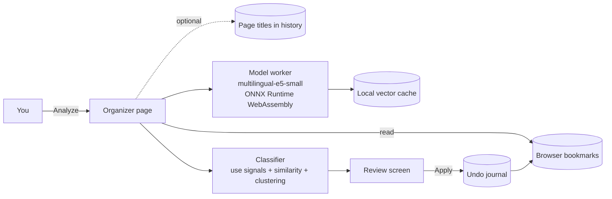

<p align="center">
  
</p>

<p align="center">
  <strong>Tidy your browser bookmarks with a small AI that never leaves your computer.</strong>
  <br>
  Free and open source, no account and no server: clear folders with emoji, icon-only bookmarks bar and one-click undo.
</p>

<p align="center">
  <a href="https://github.com/drslid/nidomark/actions/workflows/ci.yml"></a>
  
  
  
  
  <a href="LICENSE"></a>
</p>

> [!IMPORTANT]
> Nidomark is alpha software. Nothing changes before you approve the proposal, and every sort can be undone, but export your bookmarks once before your first run (`chrome://bookmarks` → ⋮ → **Export bookmarks**).

## Quick install

You need:

- Chrome 116 or later on Windows, macOS or Linux;
- about 200 MB of free disk space and 4 GB of RAM or more.

Load the extension in developer mode:

1. Download `nidomark-<version>-chrome.zip` from the [Releases page](https://github.com/drslid/nidomark/releases) and unzip it.
2. Open `chrome://extensions` and turn on **Developer mode** (top right).
3. Click **Load unpacked** and select the unzipped folder.
4. Click the extension's toolbar button, then **Analyze my bookmarks**.

The first analysis loads the model, which takes a few seconds. Each bookmark then takes about 60 ms on one CPU core, and later analyses reuse a local cache.

**Build it yourself:** see [Development](#development). **Chrome Web Store:** coming after the alpha.

## What Nidomark is

Nidomark is a browser extension that proposes a clear folder tree for your bookmarks, then applies it only after you have reviewed every change. A small multilingual model runs inside the browser, so your bookmarks never leave your computer.

<p align="center">
  
  <br><sub>Fictional sample collection used by the tests.</sub>
</p>

It understands two things about each bookmark:

- **its subject**, from the title and the address, compared with the rest of your collection;
- **its use**: a service you sign in to, an online tool, a tutorial, an article or a site you follow.

A Home Assistant dashboard and a tutorial about installing it share a subject but not a use. When your folders separate them, so does the proposal; when your "Home automation" folder already mixes both, the dashboard joins it.

### Included

- Grouping at the scale of the whole collection, reusing your folders before creating new ones.
- Home services recognised by private addresses, `.local` names, ports and personal domains.
- New folders only for three or more similar bookmarks, with short, concrete names.
- Folder names with an emoji, names only or emoji only, and an emoji picker for each folder.
- Icon-only bookmarks bar: a live preview where one click hides or shows a bookmark's name.
- Cleaner titles: notification counters and repeated site names removed.
- "To check" list when the clues are too weak, with the reason.
- Visual review before anything is written: your folder on the left, the proposed folders on the right. Open a folder to move a bookmark (menu or drag and drop), rename a new folder or skip it.
- Write-ahead journal and one-click undo that never overwrites later changes.
- Optional use of the browsing history to understand vague titles such as "Home" or "Dashboard".
- Clean Material Design interface, light or dark like your browser, in English and French.

## Architecture



The model ([`Xenova/multilingual-e5-small`](https://huggingface.co/Xenova/multilingual-e5-small), MIT, 8-bit) and the WebAssembly runtime are packaged with the extension: there is no download at run time and no remote code. Read the [development guide](docs/DEVELOPMENT.md) for the details.

## Documentation

- [Development](docs/DEVELOPMENT.md): build, test and project layout.
- [Privacy](docs/PRIVACY.md): what is read, what is stored, what is never sent.
- [Publishing](docs/PUBLISHING.md): Chrome Web Store checklist, then Firefox and Edge.
- [Security reports](SECURITY.md) and [contributions](CONTRIBUTING.md).

## Development

```bash
corepack enable
pnpm install
pnpm fetch-model   # downloads the pinned model (135 MB) and checks its hashes
pnpm check         # type check and unit tests
pnpm build         # extension in .output/chrome-mv3
```

Load `.output/chrome-mv3` with **Load unpacked**, or run `pnpm dev` for a browser with hot reload. `pnpm zip` creates the file for the Chrome Web Store.

```text
entrypoints/app         Organizer page: analysis, review, bookmarks bar preview, settings
entrypoints/background  Toolbar button and first-run page
lib                     Classifier, use signals, plan and undo, model worker, storage
lib/ui                  Canvas, side sheet and settings, without a UI framework
public/_locales         English and French messages
scripts                 Model download (pinned and verified) and icon generation
tests                   Unit tests (Vitest) and an end-to-end test in Chrome
```

## Security and scope

- The analysis runs on your computer; the extension makes no network request.
- Required permission: `bookmarks`. `favicon` shows site icons. `history` is optional and asked for only when you enable it.
- A sort never deletes a bookmark: it creates folders, moves and renames, so that undo restores the same bookmarks with the same dates.
- Every operation is written to a journal first; undo skips anything you changed afterwards instead of overwriting it.
- The extension's code is fully packaged. Its Content Security Policy only adds WebAssembly, required by the model runtime.

Not included yet: reading page descriptions, targeted history cleanup, a password-protected vault, Firefox and Edge builds. They are planned in this order.

## License

Nidomark is available under the [MIT License](LICENSE). Third-party components are listed in [THIRD_PARTY_NOTICES.md](THIRD_PARTY_NOTICES.md).
