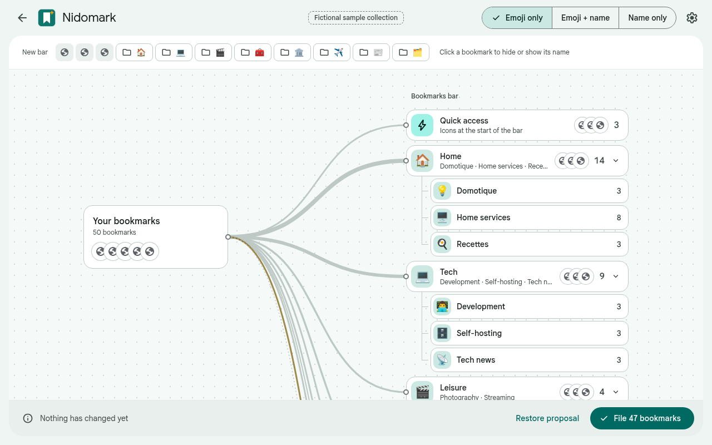
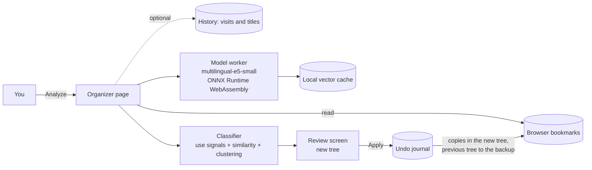

<p align="center">
  
</p>

<p align="center">
  <strong>Tidy your browser bookmarks with a small AI that never leaves your computer.</strong>
  <br>
  Free and open source, no account and no server: every bookmark recreated in clear folders, your most visited sites as icons first, and one-click undo.
</p>

<p align="center">
  <a href="https://github.com/drslid/nidomark/actions/workflows/ci.yml"></a>
  <a href="https://drslid.github.io/nidomark/"></a>
  
  
  
  
  <a href="LICENSE"></a>
</p>

> [!IMPORTANT]
> Nidomark is alpha software. Nothing changes before you approve the proposal, your previous tree is kept as it was in a dated backup, and every sort can be undone. Still, export your bookmarks once before your first run (`chrome://bookmarks` → ⋮ → **Export bookmarks**).

## Quick install

You need:

- Chrome 116 or later on Windows, macOS or Linux;
- about 200 MB of free disk space and 4 GB of RAM or more.

Load the extension in developer mode:

1. Download `nidomark-<version>-chrome.zip` from the [Releases page](https://github.com/drslid/nidomark/releases) and unzip it.
2. Open `chrome://extensions` and turn on **Developer mode** (top right).
3. Click **Load unpacked** and select the unzipped folder.
4. Click the extension's toolbar button, then **Analyze my bookmarks**.

The first analysis loads the model, which takes a few seconds. Each bookmark then takes about 60 ms on one CPU core, and later analyses reuse a local cache.

**Build it yourself:** see [Development](#development). **Chrome Web Store:** coming after the alpha. **Documentation:** [drslid.github.io/nidomark](https://drslid.github.io/nidomark/).

## What Nidomark is

Nidomark is a browser extension that rebuilds your whole collection into a clear tree, then applies it only after you have reviewed it. Every bookmark gets a place: nothing is left where it was, and your previous tree is kept, untouched, in a dated backup. A small multilingual model runs inside the browser, so your bookmarks never leave your computer.

<p align="center">
  
  <br><sub>Fictional sample collection used by the tests.</sub>
</p>

Each bookmark is filed from the most certain evidence to the least:

1. **an address only reachable at home** (NAS, box, Home Assistant) goes to "Home services";
2. **a site that no longer answers** goes to "Unreachable sites" (page removed, expired domain, server down);
3. **adult content** goes to "Porn", whatever else is known about it;
4. **your own choice** in an earlier sort, for that address or that site;
5. **a known site or a typical address**: more than 1,000 sites are recognised as streaming, news, tech news, banking, paperwork and so on;
6. **the local model** compares the title with typical bookmarks of each category and with your own bookmarks it already recognised;
7. when that is not clear, **the page itself is read** (title, description, headings), several sites at a time, and the home page of its site when the page says too little (a login form, for instance);
8. a page still unclear **follows the other bookmarks of its site** when at least two of them agree (an unclear post of a tech blog goes with its other posts);
9. if the evidence is still too weak, the bookmark goes to "❓ To check" with the reason and **up to three suggestions**; one click files it, and you can open it from the list to see for yourself.

The new tree is built for finding things again:

- **Quick access first:** the sites you open most (Gmail, YouTube…), as icons only, at the start of the bookmarks bar. Without the history, the shortcuts already in your bar.
- **About a dozen top-level folders** (🏠 Home, 💻 Tech, 🎬 Leisure, 📰 News, 🛒 Shopping…), the most used first, holding the precise categories (📺 Streaming, 📡 Tech news…) when there are enough bookmarks for them.
- **Three levels at most:** a big category is split by site or by subject ("📺 Streaming › Netflix").
- **Your folders that make sense are recreated** with their subfolders, under the category they are about, or in "🗂️ My folders" when they mix subjects ("Wedding 2025"). Catch-all folders ("Misc", "To sort", "Imported") are emptied.
- **Out of the bar:** adult content, unreachable sites, bookmarks to check and browser links go to Other bookmarks.

### Included

- The whole collection by default, the shortcuts of the bookmarks bar included, or the folders you choose.
- Quick access: 5, 10 or 20 icons of your most visited sites at the start of the bar, or none.
- New folders in the bookmarks bar (emoji only by default) or in Other bookmarks, up to three levels.
- Reading the pages of unclear bookmarks, in parallel, without cookies; nothing else is sent. Every bookmark left to check is tested.
- Dead links set apart: removed pages, expired or parked domains, servers that no longer answer. Sites behind a bot check are not mistaken for dead ones.
- Duplicates left out: one copy of each page is recreated (the one in your bookmarks bar first); the others stay in the backup.
- The previous tree moved as it was, same bookmarks and same dates, into a dated backup in Other bookmarks, and one-click undo.
- Home services recognised by private addresses, `.local` names, ports and personal domains.
- Folder names with an emoji, names only or emoji only, and an emoji picker for each folder; your own folders keep their names, and so do the folders you rename in the review.
- A preview of the new bookmarks bar, where one click hides or shows a bookmark's name.
- Cleaner titles: notification counters and repeated site names removed.
- Visual review before anything is written: your bookmarks on the left, the new tree on the right with every level of folders, grouped by where they will be created. Open any folder to see why each bookmark goes there.
- Everything can be changed before applying: drag bookmarks and folders anywhere in the tree, create folders at any level, rename, move or delete a folder (keeping or not what it holds), rename or remove a bookmark (it stays in the backup), choose for each folder how Chrome shows it (emoji, emoji and name, or name), show a bar bookmark as its icon only, and undo any change (Ctrl+Z).
- Suggestions for every bookmark to check, the most likely first, and **File all as suggested** in one click.
- **Analyze again** on any folder: a new analysis of its bookmarks with what you taught in the review, reading the pages not read yet.
- Partial sorts add to the folders an earlier sort made, instead of making a second "Tech".
- Learning from your corrections: a bookmark you file elsewhere teaches the next sorts where its site goes; undoing the sort forgets it.
- Write-ahead journal and one-click undo that never overwrites later changes.
- Optional use of the browsing history, on this computer, to find your most visited sites and to understand vague titles such as "Home" or "Dashboard".
- Clean Material Design interface, light or dark like your browser, in 21 languages chosen from the browser's own: English, French, Spanish, Italian, German, Portuguese (Brazil, Portugal), Russian, Ukrainian, Polish, Dutch, Turkish, Arabic (right to left), Hindi, Bengali, Indonesian, Vietnamese, Japanese, Korean, Chinese (simplified, traditional). Folder names follow, and your own folders are recognised in any of them.

## Architecture



The model ([`Xenova/multilingual-e5-small`](https://huggingface.co/Xenova/multilingual-e5-small), MIT, 8-bit) and the WebAssembly runtime are packaged with the extension: there is no download at run time and no remote code. Read the [development guide](docs/DEVELOPMENT.md) for the details.

## Documentation

- [Website](https://drslid.github.io/nidomark/): guides for your first sort, the review, quick access, the backup and the settings.
- [Development](docs/DEVELOPMENT.md): build, test and project layout.
- [Privacy](docs/PRIVACY.md): what is read, what is stored, what is never sent.
- [Publishing](docs/PUBLISHING.md): Chrome Web Store checklist, then Firefox and Edge.
- [Security reports](SECURITY.md) and [contributions](CONTRIBUTING.md).

## Development

```bash
corepack enable
pnpm install
pnpm fetch-model   # downloads the pinned model (135 MB) and checks its hashes
pnpm check         # type check and unit tests
pnpm build         # extension in .output/chrome-mv3
```

Load `.output/chrome-mv3` with **Load unpacked**, or run `pnpm dev` for a browser with hot reload. `pnpm zip` creates the file for the Chrome Web Store.

```text
entrypoints/app         Organizer page: analysis, review, bookmarks bar preview, settings
entrypoints/background  Toolbar button and first-run page
lib                     Classifier, use signals, plan and undo, review edits, model worker, storage
lib/data/names          Folder names in each language
lib/ui                  Canvas, side sheet, menus and settings, without a UI framework
public/_locales         Interface messages in 21 languages
scripts                 Model download (pinned and verified) and icon generation
tests                   Unit tests (Vitest) and an end-to-end test in Chrome
```

## Security and scope

- The analysis runs on your computer. The only network requests are the bookmarked pages themselves, when you let Nidomark read sites: without cookies, and nothing else is sent.
- Required permission: `bookmarks`. `favicon` shows site icons. Access to sites and `history` are optional and asked for only when you use them.
- A sort never deletes a bookmark: it creates the new tree from copies and moves the previous one, untouched, into a dated backup. Undo puts every original back at its place, with the same ids and dates, and removes a copy only while its original still exists.
- Every operation is written to a journal first; undo skips anything you changed afterwards instead of overwriting it.
- With Chrome sync on, the new tree and the backup are both synced until you delete the backup (Settings → Backups).
- The extension's code is fully packaged. Its Content Security Policy only adds WebAssembly, required by the model runtime.

Not included yet: Firefox and Edge builds, targeted history cleanup, a password-protected vault. They are planned in this order.

## License

Nidomark is available under the [MIT License](LICENSE). Third-party components are listed in [THIRD_PARTY_NOTICES.md](THIRD_PARTY_NOTICES.md).
